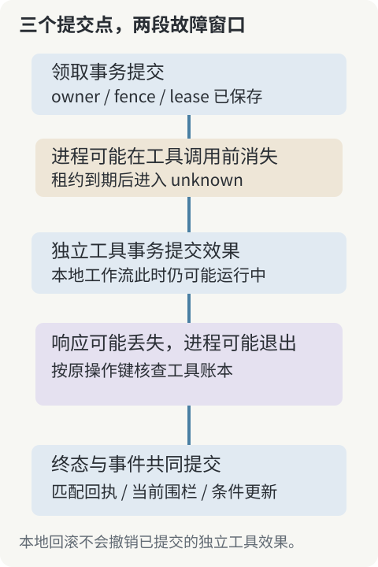

# 第 11 章：用真实进程崩溃检查恢复责任

捕获一个异常以后调用恢复函数，能够验证部分错误路径，却不能代表进程突然消失。真正的崩溃会跳过 defer、清理、日志刷新和最后一次状态保存。长任务必须在这些动作完全没有发生时仍然留下可解释的事实。

## 11.1 区分合作退出和突然终止

合作退出允许进程收到停止信号，停止领取，尝试结束在途请求，并保存已知状态。突然终止则可能不给应用任何处理机会。两者都需要验证，因为线上既有正常发布，也有进程被杀、运行时崩溃和主机故障。

随书崩溃测试启动真正的 worker 子进程，等待它到达明确阶段后发送 SIGKILL。这个信号不会运行 Go 的退出清理。因此，恢复结果不能归功于原进程在退出前主动把任务改回了就绪。

测试控制器知道子进程何时到达 after_claim 或 after_tool。这个信息只用于选择注入窗口，不作为恢复器的输入。恢复器依然只能查询数据库、等待租约和访问工具账本；这是实验能够证明恢复协议而不只证明测试脚本的关键。

## 11.2 在领取之后、调用之前终止

第一个窗口里，领取事务已经提交，任务为 running，租约还有效，工具尚未收到 POST。杀死进程以后，父进程观察到 worker 确实退出，但不能立刻无条件重新执行任务。

实验等待 PostgreSQL 时钟超过三秒租约，再把失效领取推进 unknown。对有查询能力的工具，权威账本返回没有对应效果；预算与许可检查通过后，按原操作键重排，新的 worker 完成一次调用。

观察结果中，最终效果为一，工具 POST 为一，领取尝试为二。这些数字分别对应业务效果、网络调用和执行资格，不能混作一种“执行次数”。第一次领取虽然没有调用工具，仍然消耗了持久尝试预算。

对于没有幂等与查询能力的工具，相同故障窗口会保留 unknown，效果可能为零。本实验的控制器知道工具还没收到请求，生产恢复器却没有这份直接证据。因此自动化停住，是遵守它实际拥有的信息。

## 11.3 在工具完成之后、本地终态之前终止

第二个窗口中，工具事务已经提交，worker 已取得可校验回执，但还没有保存工作流成功。随后进程被 SIGKILL，本地仍然留下 running。数据库没有因为应用进程消失而撤销工具早已提交的事务。

租约失效后进入核查，工具查询找到原操作键与匹配指纹，系统补齐 succeeded。实验中效果为一、POST 为一、领取尝试也为一：核查已经存在的结果，不需要先制造第二次执行尝试。

这条路径说明“恢复任务”不等于“重做任务”。恢复的动作可能只是读取持久事实、验证身份并补齐记录。只提供一个“从头再跑”的恢复按钮，会把本来可以通过查询完成的工作变成新的副作用风险。

## 11.4 工具完成而本地事务失败

进程未必真的退出，本地终态事务也可能失败。随书实验给事件表增加一项拒绝 completed 事件的约束，工具调用成功后，本地完成事务在写事件时失败。正确行为是状态更新也回滚，不能留下没有对应事件的本地成功。

此时工具效果仍然存在。解除实验故障条件以后，通过失效领取和权威查询补齐成功，不再次增加效果。这个实验同时验证两项边界：本地状态与事件保持原子性，外部效果不被本地回滚撤销。

约束故障是明确的数据库注入，不代表已经覆盖磁盘损坏、复制故障或数据库崩溃。读者应保留这一范围，同时认识到它已经足以暴露“工具事务与本地终态事务不共享原子性”的工程事实。

## 11.5 恢复循环也要有自己的失败处理

恢复器可能在查询工具之后、写入核查结果之前退出；两个恢复器也可能同时调查一项任务。条件更新和围栏使迟到结果不能无条件覆盖当前状态。下一次核查仍然使用原业务身份，不依赖上一位恢复器的内存。

如果权威查询本身超时，应保留未知，而不是把查询失败解释成工具没有执行。恢复任务可以退避、告警或交给操作者，但新的执行机会必须继续受预算、取消和审批规则约束。

实验不会从单个 worker 的 SIGKILL 推导数据库主机掉电后的持久性。服务故障、主机故障和存储故障是不同层次；生产设计需要为每层列出证据，尤其不能把成功重启客户端当作完成了数据库恢复演练。

**练习。** 已知工具账本有一项效果，而工作流仍为 running。请写一份恢复顺序，要求不手动篡改 succeeded、不更换操作键、不重新规划。分别指出进程退出、租约到期、权威回执和条件提交各自证明什么。
